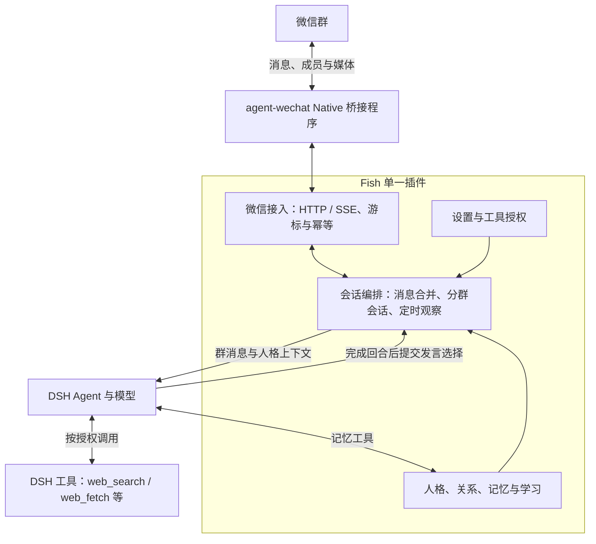

# 大肥鱼 · 微信群版（单插件）

基于 [ssamurias/dsh-fish](https://github.com/ssamurias/dsh-fish) 的二次开发，面向微信群里的长期陪伴与自然参与。本仓库保留上游的核心思路：**事件只追加，通过真实经历、回忆和修正形成持续变化的人格**。这不是训练或微调模型权重。

这是独立 fork，由 [jjggddb/dsh-fish](https://github.com/jjggddb/dsh-fish) 维护；不代表上游、DeepSeek、腾讯或 agent-wechat 官方项目。

## 本版范围

- 人格起点保存在 `seed` 事件中，已有起点不会被更新覆盖。`growth_commit` 自主记忆，`revise` 引用旧记录修正判断，`her_recall` 检索过去。
- 普通群消息与 @ 消息都进入观察队列；默认约 1.2 秒合并一个窗口，最多 16 条。同一个群串行，不同群可独立处理。
- Agent 可以旁听、只记忆或发言。`fish_decide` 明确选择 `silent` / `reply`，只有关联的 DSH 回合成功完成后，发送选择中的文字；推理文本和普通最终输出不会直接发群。
- 每群独立会话、近期上下文、日记和便条；共享同一份人格起点和事件存储。具体经历按账号及群隔离，人物使用稳定 ID，昵称仅供显示。
- 群会话默认 40 轮续接，保留旧会话，携带当前群最近 6 轮的有限原话。失败或超时的回合不会发送，并在下一轮换新会话。
- 定时主动观察不依赖 `.dev`，不掷随机骰子。需要 Fish 的参与策略与内置传输配置显式开启；代码只设置资源与发送上限，Agent 决定是否开口。
- 保留已有 PNG/JPEG 收发、引用图片读取和真正的群成员 @ 能力。图片读取要求 DSH 当前模型支持图像。
- 管理面板展示连接、观察/发送状态和近期记忆，支持配置参与节奏、选择 DSH 工具授权和导出人格备份。

本版已删除 B 站浏览/登录/评论/视频、出门工作、请神、纪念品、桌面通知、插件内自行下载安装更新，以及单主人冷落剧情、固定阶段的表达限制和对应界面。历史事件类型仍兼容读取。小红书、表情库、语音不在本版范围内。

## DSH、Native 与 Fish 完整链路

**DSH 内只安装本仓库一个业务插件。** Fish 内置微信接入、持久队列、会话编排、人格和工具授权；DSH 负责 Agent 推理与工具执行。agent-wechat Native 仍作为独立的底层微信桥接程序运行。



| 层 | 职责 |
| --- | --- |
| [DeepSeek Harness](https://github.com/deepseek-ai/deepseek-harness) | 模型调用、Agent 会话、工具注册与执行、附件、Web 管理与认证 |
| [agent-wechat](https://github.com/thisnick/agent-wechat) Native | 微信登录、消息与成员、媒体、发送回执 |
| Fish `lib/wechat/` | 内置 Native HTTP/SSE 接入、账号/群校验、持久 inbox、重连游标和幂等发送 |
| Fish 会话与人格模块 | 消息合并、定时观察、分群会话、人格与记忆、参与决策及发送限制 |

收到消息后，Fish 直接向 DSH 会话提交输入；模型决定是否记忆、调用已授权的宿主工具或回复。DSH 将工具结果返回 Agent。Fish 仅在关联回合成功完成、明确选择回复并通过发送检查后，经内置传输模块调用 Native 发群。

无需独立的 `dsh-wechat-native` 插件、调度中心、WebSocket 或桥接 Agent。额外能力由 DSH 注册工具，Fish 只管理授权，不复制这些工具的实现。

## 安装与连接

集成基线：Node.js ≥ 22.19、DSH `0.2.1-rc.5`、Native `1.5.1`。自动化测试使用本地模拟 Native 接口与 DSH 会话，不能代替真实宿主和微信客户端验收。

1. 按 DSH 与 Native 各自项目说明准备服务。Native 启用 API token；从 Native 查询实际账号、机器人身份和精确群 ID。
2. 在 DSH profile 安装 Fish：

   ```sh
   dsh plugin --profile my-profile add git+https://github.com/jjggddb/dsh-fish.git#wechat-deployment
   ```

   本 fork 位于 `wechat-deployment` 分支，安装时不能省略分支后缀。生产部署应使用验证过的完整提交 SHA。插件不会在运行时自行更新代码。
3. 在 profile 的 `cordis.patch.yml` 中配置唯一的 Fish 节点，并通过宿主环境提供 `WECHAT_NATIVE_TOKEN`。以下是占位示例：

   ```yaml
   - insert:
       - id: dsh-fish
         name: dsh-fish
         config:
           root: /data/fish
           wechat:
             enabled: true
             baseUrl: http://127.0.0.1:6174/
             tokenEnv: WECHAT_NATIVE_TOKEN
             accountId: YOUR_NATIVE_ACCOUNT_ID
             selfId: YOUR_BOT_WECHAT_ID
             groups:
               - id: '123456@chatroom'
                 name: '你的测试群'
             dataDir: /data/wechat-transport
             initialCursor: '0'
             sending: false
             scheduledSending: false
             maxMessageAgeMs: 300000
   ```

   若安装命令已生成 Fish 节点，修改现有节点，勿重复插入。`wechat` 默认关闭，`sending` 与 `scheduledSending` 默认关闭。未设置 `dataDir` 时使用 `<root>/wechat`；该目录必须持久保存。Native 地址仅允许回环 HTTP 或验证证书的 HTTPS；分容器连接应配置受控 HTTPS 地址。
4. 重载 profile，在 Fish 管理面板确认连接正常，再在同一 Fish 配置中启用 `wechat.sending: true` 并重载。观察可以在发送关闭时运行。
5. 如需定时主动参与，同时设置 `wechat.scheduledSending: true` 与 Fish 运行配置 `proactive.enabled: true`。定时器只遍历已授权群；Agent 不接收任意目标群参数。

DSH 需要可用的 `workspaceRegistry`、`sessionController`、`agents`、`tools`、`systemPrompt`、`webServer`、`connection` 服务；图片读取还需要 `attachments` 和支持图像的模型。微信连接参数放在 profile 的 `config.wechat`；人格运行参数放在 Fish 数据目录的 `config.json`，由同一 Fish 管理面板管理。

### 从双插件版本迁移

1. 停止原 profile，备份 Fish 数据目录与 Native 插件的整个传输数据目录（包括 `native.sqlite` 及存在的 WAL/SHM 文件）。
2. 删除 profile 中的 `dsh-wechat-native` 插件节点。将原节点的配置原样移到 Fish 的 `config.wechat`，删除旧的 `config.nativeChannel`。
3. **保留原 Fish `root` 和传输 `dataDir` 路径。** 旧 Native 插件未设置 `dataDir` 时，实际目录是 `$DSH_HOME/storages/dsh-wechat-native`（默认 `~/.dsh/storages/dsh-wechat-native`），迁移时显式填入该绝对路径。
4. 重启 profile。原事件、人格 seed、群会话、游标、发送幂等键均继续使用；已有数据库不会因 `initialCursor` 重置。无需搬迁或改写记忆。

不要同时运行旧 Native 插件与内置接入。Fish 检测到宿主已加载旧 `wechatNative` 服务时会拒绝启动内置接入；旧 `nativeChannel` 配置也会提示迁移。迁移不自动打开任何发送开关。

### DSH 工具授权

Fish 设置页的「DSH 工具授权」列出宿主已注册的工具，默认授权 `web_search` 与 `web_fetch`；宿主未提供时显示不可用，不自动安装。勾选并保存后重启 DSH Host 生效。管理员也可通过已认证的 `GET /dsh-fish/tools` 获取工具目录，通过 `POST /dsh-fish/config` 保存 `tools.allow`。

授权对象是**工具名**：同一个插件提供的多个工具可分别选择。保存时拒绝新增的未知名称；当前暂未注册的已有配置可以保留或移除。Fish 在自己的 Agent 上应用可见范围限制与执行守卫，不影响其他 Agent。DSH 的 Agent 自有工具不受宿主 `restrict` 隐藏，但未授权调用仍被执行守卫拒绝；宿主更严格的限制依然有效。

不再把可选工具硬编码成两个网页工具，也不自动开放宿主全部能力。shell、文件、子代理或外部发送类工具只有管理员明确授权才可能使用；这类工具可能访问额外数据或产生外部副作用，不受 Fish 内置群发送队列的约束。只为群聊授权适当的工具。小红书、表情库、语音的实际插件实现留待后续版本。

## 环境参数

Fish 在数据目录读取 `config.json`，未设置的项自动补默认值。可以从 DSH 已认证的 `/dsh-fish/config` GET/POST 读取/更新，或停服后编辑文件；未知的旧功能配置不再生效。

```json
{
  "group": {
    "batchMs": 1200,
    "maxBatch": 16,
    "maxTurnsPerHour": 60,
    "maxRepliesPerMinute": 3,
    "quietHours": [0, 8],
    "timezone": "Asia/Shanghai"
  },
  "proactive": {
    "enabled": false,
    "intervalMinutes": 120,
    "maxPerDay": 2,
    "minIdleMinutes": 30
  },
  "chat": {"rotateAfter": 40, "replyChars": 1500},
  "memory": {"docBudget": 8000, "beliefsShown": 8},
  "diary": {"enabled": true, "visible": false},
  "tools": {"allow": ["web_search", "web_fetch"]}
}
```

- 上限均按群计算。定时额度限制的是**观察次数**，包含选择沉默或失败的回合；不保证每天一定发言。
- 静默时段和额度限制会跳过当前观察窗口并记录原因；不积攒延迟回复。Fish 内置传输仍保存已接收消息，近期消息工具可以在后续合法回合查看。
- 每分钟检查一次定时机会。进程重启不补发错过的时段，已预留的观察次数持久保存，避免重启重复触发。
- 批量窗口、工具名单需要重启 DSH Host 生效；静默时段、额度、记忆与轮换参数在后续回合读取。
- 不提供人格滑条、好感度数字或直接覆盖 seed 的编辑器。人格文档优先保留完整 seed，特别长的历史 seed 可能超过文档预算。

## 记忆与升级

`events.jsonl` 是唯一的长期经历来源，只能追加。新事件在原 v1 信封上增加可选的 `scene / accountId / groupId / personId / messageId / turnId`，没有改写旧字段语义，不需要重写旧事件。

- **已有 seed 和事件不会重置或重新播种。** `deriveSelf`、引用修正、显著性排序和冲突检测继续用于人格生成。
- 旧事件若带有可确认的 DSH 群会话 ID，会在读取时归属到该群；轮换保留旧会话 ID 映射。这个归属只在内存中做，不修改原始日志。
- 无法确认来源的旧记录保留在备份和管理员记忆视图中，不猜测属于哪个群，也不跨群向 Agent 暴露。
- 新日记和便条按账号及群保存到 `groups/<scope-hash>/`。旧的私人日记、便条原样保留，不自动共享进群。
- `channels.json` 记录会话及轮次；`talk-recent.json` 保存各群续接片段；`group-state.json` 保存限额与最多 80 条运行摘要。这些与人格事件分离。
- 使用管理面板导出人格、配置和群会话备份；运行中的 SQLite 传输数据库会明确列为跳过，必须停服后单独备份整个传输目录。恢复工具会先封存旧目录。恢复只能停服后由管理员执行，不给 Agent 开放。备份包含私人记忆，不能提交到仓库。

升级前备份数据及当前提交 SHA；升级 Fish 时保留原数据卷。回滚代码不能恢复已丢失的会话/限额元数据，务必同时留备份。旧发布历史在 Git 中可查。

## 权限与可靠性

Fish 的工具名单约束宿主工具可见范围和执行权限，默认不开放系统操作能力。外部工具的文本结果、群消息、昵称及引用统一经 `guard.js` 清洗并标为外部资料；这不能把任意第三方内容变成可信指令，仍需部署边界配合。

- 容器不挂宿主目录、Docker socket 或其他项目的数据卷；业务进程使用非 root 用户，按部署环境阻断宿主、私网及云元数据访问，仅保留确实需要的服务出口。
- Native API token 和模型凭据只留在私有配置或环境中。Web 管理必须保留 DSH 的认证；认证服务缺失时 API 拒绝访问。
- 发送绑定精确账号和群。主动发送使用宿主签发、限时有效的回合能力及持久幂等键；不接受模型自行指定群地址。
- Native `accepted` 表示服务接受发送，并不等于手机已阅读。发送结果不明时检查原幂等键，不盲目换键重发。
- 传输 inbox 的处理中任务在重启后标为 `interrupted`，不自动重放以免重复发言；pending 消息仍受时效限制。
- 插件工具权限不是操作系统沙箱。网络隔离、进程用户和卷挂载由部署负责，不由此 JavaScript 插件提升或放宽。

## 开发

```sh
node --test
```

保持零 npm 依赖，使用 Node 内置 SQLite。`npm run build` 从固定版本的上游 TypeScript 源码生成 Native SDK，校验来源 SHA-256；`npm pack` 自动执行生成。保留核心事件、派生、存储、日记、锁和安全检查的测试；删除只针对已移除上游功能的测试，并补充分群隔离、旁听记忆、批处理、会话续接、失败不发送、定时限额等回归测试。内置传输及单插件接入测试也在本仓库运行。

公开仓库只保存源码、测试和通用示例。真实服务器、账号、群 ID、登录信息、模型 key、用户提供的人设原文与运行备份均不入库。

## 来源与许可

核心代码派生自 [ssamurias/dsh-fish](https://github.com/ssamurias/dsh-fish)，保留 MIT 许可与原版权声明；二次开发说明见 [THIRD-PARTY-NOTICES.md](THIRD-PARTY-NOTICES.md)。内置传输移植自自己的 dsh-wechat-native；Native HTTP SDK 保留上游 MIT 许可和来源哈希。本仓库不附带微信账号、登录态或 Native 二进制。
